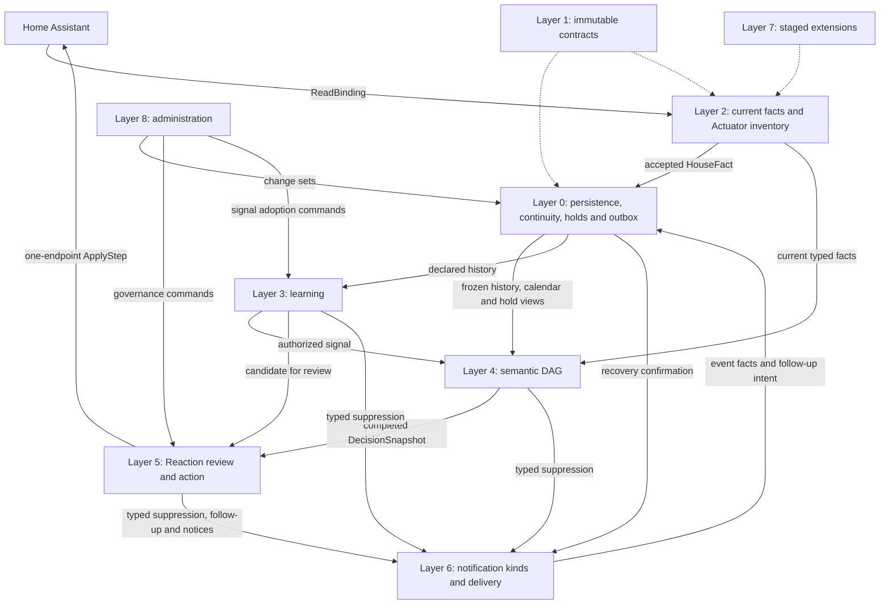

# Heima v3 — Architecture Recap

Status: **synthesis of the full v3 design, not a spec.** This document describes how the v3
architecture is meant to work, end to end, organized by logical dependency layer. It does not assume
familiarity with any earlier version of Heima. Each block links to the backlog section or draft file
where the full reasoning/evidence trail lives, for anyone who wants to go deeper — but the recap
itself should be enough to understand the system on its own.

**Authority and maintenance.** The Layer 0--6 and Layer 8 specifications are authoritative; where this recap
differs from one, the specification wins. This is a manually maintained orientation document and is
updated whenever a confirmed decision is promoted into an authoritative specification. **Reviewed
through:** 2026-10-14 for every CA4 correction closed in `docs/v3_backlog.md`, including the
CA4-64 (CA5) and CA4-86–96 (CA6 and follow-ups) corrections; no CA4 item is open.

For current specification work, the [contract registry](specs/v3/contract_registry.json) and
[workflow](specs/v3/spec_workflow.md) provide bounded navigation and review evidence.

Out of scope, explicitly: `chi` (per-person learning — Heima learns at the household level, not per
resident), push-model extensions (extensions are invoked by the core, never push data in on their
own), and loading third-party code in Initial V3 (Layer 7 §11). V3 uses a deliberate clean-start cutover: it does not migrate V2 configuration, history,
runtime state, or learning; a V2 export can exist only outside V3 as rollback/reference material.

```
Layer 8  Admin / config surface        one role-based panel, atomic change sets, history, why
Layer 7  Extensions                    first-party boundary, off-cycle, facts and candidates only
Layer 6  Notification / communication  one pipeline, family quiet hours, digests
Layer 5  Action / reaction generation  Reaction descriptors, review and safe application
Layer 4  Semantic Resolution (the DAG) independent semantic claims and episodes
Layer 3  Learning / pattern recognition PatternLearner, bounded live signals, proposal analyzers
Layer 2  Registries                    Sensor + Interpretation + FusionRule, Actuator
Layer 1  Substrate primitive           HouseFact: WHAT/WHERE/WHEN/HOW, Location/Zone/Topology
Layer 0  Cross-cutting runtime         Timing, Persistence, FactSource/ApplyStepSource, holds, recovery
```

Layers 0-1 are one foundation slice, with distinct ownership and a bounded reciprocal dependency on
immutable contracts: Layer 0 owns runtime mechanisms and `FactSource`; Layer 1 owns `HouseFact`,
`Provenance`, and spatial value objects. Neither invokes the other's behavior in a cycle. Layers 2-5
are what the engine *does* each cycle. Layers 6-8 are how a human (or another program) *sees and
steers* it. Layer numbering is current as of this revision; it is not load-bearing outside this
document.

---

## Full logical architecture — diagram



The current detailed diagrams separate [runtime and authority](specs/v3/architecture_runtime_authority.puml)
from [support, learning and delivery governance](specs/v3/architecture_support_governance.puml).
The older `img/v3_architecture.dot` and its generated PNG retain superseded architecture
concepts and are historical reference only. The overview explains the arrows and ownership
boundaries of the current diagrams.

---

## Layer 0 — Cross-cutting runtime facilities

Six facilities (Layer 0 §1; historical observation continuity, listed separately below, belongs to
Persistence) that sit outside the semantic-resolution DAG entirely — nothing in Layers 2-5 can
depend on them changing mid-cycle, and nothing here depends on a semantic claim.

- **Timing**: one execution primitive, an "at" job — a scheduled one-shot deadline. A "cron" policy
  layer sits on top of it: in Initial V3 an elapsed `IntervalRecurrence` computes the next due time
  and re-arms an "at" job each time it fires (`WeeklyRecurrence` is only a civil time-window value for
  descriptors and bucketing, not a cron pattern). This is how every **Heima-owned** recurring or periodic job works — a periodic
  safety-net re-evaluation, for example — each is a `CronEntry` owned by whichever subsystem needs it,
  not a separate bespoke timer mechanism per feature. Admin-authored recurrence instead belongs to an
  HA `schedule.*` helper; Heima consumes only its effective state as an ordinary sensor fact and never
  duplicates HA's schedule picker or timezone/DST logic. That rule covers standalone schedules; a
  descriptor-declared time-window parameter that only limits when an already activated Reaction may
  act, such as the presence-simulation session, is Reaction configuration (Layer 0 §3.1).
  Every declared V3 instant, including fact, job and model-artifact fields, is the same canonical
  UTC `EvidenceInstant` with six fractional digits and `+00:00`. Every positive elapsed duration,
  including model horizons and registry delay summaries, is the same `Window` with canonical
  seconds. Internal calculations can use other forms temporarily; contract fields and artifact
  serialization cannot. Calendar weekday/hour/minute values are civil coordinates.
  `Window` (a bounded time span) is a separate, non-executing comparison type used for dwell timers
  and correlation/follow-up matching — "has this been true for at least N seconds," "did Y happen
  within N seconds of X." `LearnedWindow` is a `Window` that starts from a seed value and calibrates
  itself from observed `HouseFact` history over time, usable anywhere a plain `Window` is used, not
  a feature bolted onto one specific reaction. `CalendarWindow` extends the same "something at
  instant T" idea to an externally-sourced, named interval with an absolute start/end (a vacation,
  a holiday, a work day) instead of a relative or recurring one. Layer 0 exposes both active windows
  for current facts and complete future windows within a consumer-declared horizon for predictive work
  such as notifying today about tomorrow's event; calendar awareness is Timing infrastructure,
  evaluated before the core DAG runs each cycle, not a semantic resolver or an extension.
  Duration and civil-time values are validated at configuration staging or dynamic job registration,
  never repaired or rechecked per cycle. Every cycle gets a strictly increasing cycle instant
  (`max(clock, previous + 1 µs)`), so history never moves backward; each job declares an
  `elapsed` or `wall_clock` basis, and a clock jump over 1 second re-arms `wall_clock` jobs and
  records a `clock_discontinuity` observation gap (Layer 0 §3.1/§3.5).
  → Layer 0 §3 is the current timing contract; `v3_house_fact_draft.md` is historical.
- **Persistence**: `HouseFact` storage is **always atomic** — one fact per WHAT/WHERE/WHEN/HOW,
  never a bundled record. It has two tiers: a durable long-term store (for learning and audit) and
  a short-term in-memory buffer (for correlation/follow-up matching within a bounded recent window),
  because those two needs have genuinely different cost profiles — the fast path can never wait on
  disk I/O. A producer declares each fact family as `state` or `event` at composition: state facts use
  canonical identity and write-on-change; unchanged state observations append nowhere, while every
  distinct state transition is retained in deterministic internal append order and latest-state lookup
  remains O(1). Events append every occurrence and are never current state. `HeimaEvent` is
  a transient delivery envelope; its durable audit representation is an event `HouseFact`,
  and delivery deduplication never erases history. During a storage outage the retry queue is
  bounded by `max(32 MiB, 5% of effective memory)`; overflow first collapses superseded state
  transitions, then drops oldest events, and declares each loss as a `queue_overflow` gap.
  If protected items alone exceed the budget, Layer 0 declares a global gap and
  progressively re-seeds durable baselines after fresh HA intake (Layer 0 §4.6). The global
  gap can close before all keys recover; each unseeded key stays durably unknown without
  changing live source availability. A core component outside the
  DAG learns of a committed state change through a core subscription to exact keys (declared at
  bootstrap or derived from the active generation), delivered after the cycle (Layer 0 §4.8). Facts and projections are deeply immutable once constructed (Layer 1 §3). The same bootstrap pass reserves fact-type
  ownership across layers, preventing a registry producer from colliding with a Layer-0-owned
  family such as hold lifecycle events. A "snapshot" (everything true at
  one instant, or in one place, over one window) is never its own stored shape; it's a query
  reconstructed at read time. A separate durable process-continuity watermark, advanced
  every 60 seconds only after earlier fact and audit writes are acknowledged, bounds the
  uncertain tail after a crash. A normal stop and the first durable `CycleInputBarrier`
  built from a newly completed HA intake with explicit binding availability delimit
  a known interruption. Windows crossing it are incomplete even when retention is
  complete; one unreadable Actuator makes only its dependent windows incomplete.
  Unchanged values keep their last-change `HouseFact.when`; a declared HA
  report-age gate uses `last_reported`, and durable per-stream gap boundaries
  record known observation breaks. Historical state age is never inferred
  from the last change alone, and a newer unavailable state cannot be skipped.
  One bounded `actuator.channel_state.<digest>` state stream per registered
  channel records physical/availability changes and the first fresh
  post-restart state. Its edge id joins the unchanged three-field verified
  `actuator.manual_control` event (with its coarse `ControlActor`, CA4-119). Layer-5
  `actuator.target_lifecycle` phases record admitted target decisions,
  first complete observations and closures; Layer 3 joins these with
  `actuator.correction` and typed coverage for routine and correction
  learning. An unavailable bulb after a wall-switch power cut has no
  inferred resident edge or correction.
  → `v3_backlog.md` §`HouseFact` persistence model, CA4-05, CA4-09 and CA4-33.
- **`FactSource` / `ApplyStepSource`**: one structured-provenance vocabulary spanning both facts and
  actions — every `HouseFact` and every `ApplyStep` carries a `kind` (sensor, analyzer, extension,
  reaction, admin command, resident response, timeout, recovery, system...), a `source_id`,
  an `actor_type`, and a `correlation_id`. Non-forgeable (an untrusted or malformed source gets
  sanitized into a clearly non-authoritative value, never silently trusted) and redacted before it
  reaches diagnostics or storage. This is what makes "why is the house in this state" answerable:
  follow one `correlation_id` from a resolved state back through the facts that fed it to whatever
  produced them. An extension-related `ApplyStepSource` is provenance only; it never grants an extension a
  direct command capability.
  → `v3_backlog.md` §Observability, re-grounded.
- **Divergence Hold Manager**: residents use ordinary HA device controls. Layer 0 §6 tracks
  one process-local hold per Actuator channel when a valid observation diverges from a
  confirmed current Reaction target; facets share its release boundary and audit records
  their expectation sources. Layer 5 §6 defines descriptor release, normal exit and follow-up.
  Restart restores no hold; Layer 0 §7 uses any retained baseline only for a fresh
  current-policy recovery decision. The earlier domain-wide explicit/implicit hold model is
  historical (CA4-01).
- **Historical observation continuity**: declared durable history reads carry typed
  `ObservationCoverage` separately from retention. After restart, the process gap
  closes at the first durable `CycleInputBarrier` from a fresh complete HA intake;
  unreadable individual channels remain incomplete only for dependent windows,
  while readable channels resume current policy. A timer-only cycle or cached state
  cannot certify continuity.
- **Recovery / Checkpoint**: a lightweight, pre-DAG context computed once per evaluation cycle,
  before any semantic resolver runs — it classifies runtime state (normal / just started / recovering from a
  power loss / degraded because many entities are unavailable / settling back to normal) and makes
  that classification available, read-only, to everything downstream, so behavior can be
  conservative and explainable right after Home Assistant restarts or during a partial outage.
  Backed by a deliberately minimal checkpoint — only an allowlist of critical entities' attributes,
  redacted, written on a periodic cadence (itself a `CronEntry`, owned by this subsystem — Recovery
  consumes Timing's execution primitive like everything else that needs periodic work). It answers
  "did anything change while Heima was offline" cheaply; it is not a general restore mechanism, and
  it never forces every piece of runtime state through the full `HouseFact`/`Provenance` shape —
  some state (like this one) is narrow and minimal on purpose, not by oversight. An opted-in
  Actuator's coalesced per-channel, per-facet desired-target checkpoint is a read-only
  baseline for current-policy
  recalculation after power recovery, never a command replay. `FactRef.previous_cycle` reads
  a sealed in-memory snapshot; an unclean restart cannot claim older durable history as its
  immediate predecessor. Every configuration change in Layers 2–6 activates as one composed generation: a
  durable manifest swaps all layers together between cycles. An edit that breaks a downstream
  resolver, learner or Reaction needs the administrator's confirmation of its impact record;
  the commit then invalidates those dependents (a Reaction becomes `configuration_invalid`
  until a valid successor), while a semantic-only upstream change is only listed (Layer 0 §4.7).
  Each baseline facet retains its Reaction generation or trusted direct-command
  origin. A removed, edited or consent-revoked Reaction loses its baseline facets;
  surviving facets still pass current target and safety admission.
  The cycle's `DecisionSnapshot` freezes recovery state, episode and exposed
  baselines together with current Reaction authority; later checkpoint writes
  or consent changes require a new decision and cannot rewrite that snapshot.
  Declared `state_transition` triggers compare a typed previous/current state
  pair in that same completed snapshot; a missing predecessor after restart
  abstains, and explicit episodes retain their separate event meaning.
  **Hold restart rule**: an active channel hold is never restored from a checkpoint after a
  restart; the first returned observation does not create one. An open recovery-target
  confirmation request also loses authority on restart. While running it remains open
  only for the same admissible proposal, with a 24-hour core ceiling; fresh readings
  and recalculation can create a new request after restart when still needed (CA4-39).
  → `v3_backlog.md` §"Manual Hold Manager / Recovery-Checkpoint" +
  §"Full architecture re-review", AR-3; `docs/specs/v3/layer0_runtime_spec.md` §§6–7.
- **Runtime health telemetry**: a read-only capability and resource snapshot serves slow-path
  learning admission; Layer 0 measures but never chooses a learner or action.

---

## Layer 1 — The substrate primitive

- **`HouseFact`**: `fact_type` + `value` + `where: Location` + `when: EvidenceInstant` + `how: Provenance`.
  This is the one persistent shape for an assertion about the house or an auditable operational
  occurrence: a sensor reading, a fused derived state, a resolved semantic claim, or a declared event
  fact. It is not a generic message or workflow container: a transient `InferenceSignal`, a
  `LearningProposalCandidate`, a reviewable `ReactionProposal`, and an `ApplyStep` each retain their
  own contract and lifecycle.
- **`Location`**: always present on a `HouseFact`, never absent. Four forms: `casa` (the whole
  house, the root), a single `room`, a declared `zone`, or `rooms` — an ad hoc, unnamed set of room
  IDs, needed when a fact is genuinely scoped to a dynamically-observed combination of rooms that
  isn't a standing, admin-declared `Zone`.
- **`Zone`**: an admin-declared, named group of rooms — Heima-owned data, not a live reference to
  Home Assistant's own label/grouping features (those can *suggest* a zone at creation time, nothing
  more). A room can belong to several zones at once; zones are not nestable — a zone groups rooms
  directly, never other zones.
- **`Topology`**: a third, complementary piece of WHERE, distinct from both `Location` and `Zone`.
  `Location` says *which* place a fact is about; `Zone` says *an explicit group someone declared*;
  `Topology` says *how rooms physically relate to each other* — each room's enclosure
  (interior/exterior, e.g. a terrace is exterior), what lies across every opening (windows included),
  passable doors and doorless passages (stairs, archways), orientation, floor. It stores only physical facts — no security or thermal
  classification — and every consumer asks the same derived questions ("does this opening face
  outside?"). Purpose-specific groups (thermal envelope, a future security perimeter) are Zones with
  a closed core role, as IFC does with `IfcZone`. It is not itself a fact producer or a fusion input —
  it's context that `FusionRule`s, Reactions, and Reaction-descriptor requirements can query when
  deciding whether and how to act.
  → Layer 1 §5–§7 is the current location/topology contract; `v3_house_fact_draft.md` is historical.

---

## Layer 2 — Registries (who produces / consumes facts)

- **`Sensor`**: `binding: ReadBinding` + `where: Location` + `fact_type` + an `Interpretation`
  (resolved 2026-09-08, Layer 2 §3.1). Every Home Assistant **readable signal path** Heima cares
  about is registered exactly once, here — one registry, not several independently-configured entity
  lists for different purposes. A signal path is more precise than an entity id: the same HA entity can
  legitimately produce several `Sensor`s through distinct bindings (e.g. `climate.*` state,
  `current_temperature`, `hvac_action`) while the producer uniqueness invariant stays
  `(fact_type, Location)`, not "one sensor per entity." A `ReadBinding` only extracts the raw input for
  the current cycle (`state`, one attribute, or Layer-0-extracted active calendar windows); an
  `Interpretation` is how that raw input becomes a typed `HouseFact` value, one per genuinely distinct
  decoding mechanism, not one per HA domain (resolved 2026-09-05, collapsing three hardcoded-vocabulary
  variants — boolean/presence/media-activity — into one): an exact-match mapping (a configurable
  raw-string-to-value table plus a default for anything outside it — a `default` value makes it total,
  e.g. boolean on/off; `default=NO_DEFAULT` makes an unmapped state mean "no signal," e.g. a lock or
  alarm vocabulary that only speaks for the states it knows; `default=None` is a real produced value,
  not the sentinel), strict finite numeric normalization to a `float`, a bucket vocabulary (ordered
  numeric thresholds, e.g. dark/dim/bright), or calendar-window aggregation composed with the reusable
  pure `KeywordClassifier` (fuzzy keyword matching with a priority order for conflicts, open-ended by
  nature since admins define the keywords).
  Core solar geometry uses this same Sensor path: two reserved casa facts read
  `sun.sun` elevation/azimuth attributes from one HA snapshot, gate stale or
  invalid source values and convert degrees to canonical radians. The
  per-opening solar-incidence formula keeps each orientation in its staged
  configuration. Solar position is not a learner-owned forecast.
- **`FusionRule`**: how N facts become one derived `HouseFact` — inputs may come from `Sensor`s, or
  (resolved 2026-09-04) from another `FusionRule`'s own output, addressed uniformly by
  `fact_type`/`Location` rather than by producer id. A genuinely separate concept from `Sensor`, not
  folded into it, because not every sensor needs fusing (a context-recording sensor can stand alone)
  and not every fusion has just one shape. `FusionStrategy` is a **closed union of five kinds**, not
  an open-ended registry (resolved 2026-09-02, AR-4 follow-up — an earlier version of this recap
  described the strategies as living in "an extensible registry," which turned out to conflict with
  the actual drafted type; the closed union preserves exhaustive pattern-matching, which the project
  favors consistently elsewhere in this model): direct passthrough (relabel one fact under a new
  `fact_type` — always exactly one input, `Location` unchanged; resolved 2026-09-05, no real use case
  survived for changing location during a passthrough), unanimity (true only if every currently-
  available input agrees — resolved 2026-09-08, renamed and narrowed from a `BooleanSetStrategy`
  with an any/all mode: "any" was a pure redundancy with weighted quorum at weight=1/threshold=1.0,
  since "at least one" never needs its bar to scale with population size; "all" survives as its own
  strategy because unanimity's boolean-`True` bar must scale with how many inputs are actually available each cycle,
  which a fixed weighted-quorum threshold cannot express), weighted quorum (also covers a plain count
  threshold — every weight equal to 1 — and, resolved 2026-09-07, deliberately never folds in each
  input's own confidence/reliability, only its configured weight, since weight already is that lever
  and a second one would risk contradicting it), precedence (an ordered fallback chain: try each
  source in order, first definitive value wins — the one strategy allowed to mix source locations
  freely, since a fallback may legitimately be coarser or differently-scoped than what it
  approximates), and
  a fifth, deliberately narrow `FormulaStrategy` for cases where the combination is a genuine
  calculation rather than a generic pattern (e.g. combining temperature, wind, and humidity into one
  effective value, or Heating's Season derivation) — this one variant carries no calculation logic
  itself, only a reference into a separate, core-team-curated formula registry (mirroring
  `NormalizationFusionRegistry`'s existing plugin pattern), so a new formula never requires reopening
  `FusionStrategy` or any code that pattern-matches on it. Each registered formula explicitly declares
  whether confidence is continuous (value plus dispersion), categorical (value plus support/total),
  or inherited from one declared available input; it receives the complete ordered input sequence,
  including unavailable facts, so it can distinguish missing from negative evidence without I/O or
  hidden state. `physical_evidence.weighted_evidence` additionally receives a typed per-input binding
  of role, true/false weights, false requirement, explicit admission, and correlation group. It
  supports both room and casa `occupancy.physical` (CA4-120): one correlated physical source
  family contributes at most one vote, and only explicitly immediate evidence may take the fast
  primary path. New sensor kinds alter configuration rather than formula code. A formula configuration
  is persisted as bounded canonical JSON and compiled once during generation staging into that
  formula's private immutable type; the evaluator never parses it. The Initial-V3
  solar-incidence and humidity-ratio formulas use this same closed mechanism for a
  staged opening orientation and an exclusive pressure-source choice.
  The formula catalog is core-built and frozen before cycles; its immutable id and semantic
  implementation version are persisted with each resolved binding, while callables are not.
  A changed version selectively invalidates only dependent fusion rules. No formula is assumed
  continuous merely because it calculates something. `Stability` commits a no-dwell transition in the
  same cycle, while a positive dwell owns one token-checked deadline that re-evaluates current
  in-memory inputs at expiry rather than polling or committing an old candidate. It can additionally
  retain a committed boolean result for an explicitly bounded unavailable grace, armed by one deadline
  and never restored after restart; it cancels, rather than completes, an interrupted directional
  dwell. A
  `FusionRule`'s output can carry its own
  stability/dwell `Window`, independent of which strategy produced it — debounce and hysteresis are a
  property of *any* derived fact's stability over time, not specific to one combination method.
  Each fusion owns its compact ephemeral control state, while Layer 0 supplies only deadline jobs and
  historical fact buffering; this keeps control lookups O(1) and avoids treating runtime state as
  history.
  Resolved 2026-09-12: only a `FormulaStrategy`, after its core binding validator has explicitly
  allowed it, can address its exact own *previous*-cycle value (`FactRef.previous_cycle=True`). This
  narrow self-memory makes a recursive/temporal computation (a Bayesian filter using its own last
  posterior as this cycle's prior, an exponential moving average) expressible without a sixth strategy
  or breaking `compute`'s pure signature. The memory arrives as an ordinary `HouseFact` input from
  Layer 0's sealed in-memory snapshot; only after a clean restart is that snapshot pre-hydrated from
  the matching committed durable state.
- **`Actuator`**: an inventory fact only — which entity, where, optionally which physical opening it
  operates, optionally which coarse role it plays (light, shutter, HVAC unit, water valve, switch...
  — deliberately an open string, never a closed enum, since HA's own device domains keep growing),
  and, for fixed-duration hold release, one configured positive duration shared across its
  fixed-duration channels. Each channel still gets its own deadline. A hold never
  survives restart; the Actuator record is never itself a command. One HA command endpoint has one
  Actuator record; an optional opening must belong to its room, while lights and other ordinary room
  equipment have no opening relation. An optional `is_external` (IFC `IsExternal` semantics) says
  whether the device itself is mounted outside; with the opening it derives a conservative
  `weather_exposed`, used for example to require a wind guard for an exterior awning. Commands live only in whichever
  Reaction decides to send them. → `docs/specs/v3/layer2_registries_spec.md`; the older
  `v3_sensors_actuators_draft.md` remains background only and no longer reflects the current `Sensor`
  shape.

---

## Layer 3 — Learning / pattern recognition

Mines the history Layer 2 produces; it is not itself a fact producer in the live, per-cycle sense
Layer 2 is — it runs on its own slow cycle (on the order of hours), reading accumulated `HouseFact`
history rather than the current cycle's live entity states. The one exception is serving: an adopted
live `InferenceSignal` is emitted inside the cycle, after Layer 2 and before Layer 4, from bounded
declared inputs.

Learning requests a retention duration from Layer 0, but that request is not allowed to defeat the
50,000-record per-`fact_type` hard ceiling or the 512 MiB global pruning watermark. Each history read
carries retention coverage; a pruned requested window keeps the learner in warm-up/degraded mode rather
than letting it infer from a silently shortened sample. Latest state records remain protected even
under global storage pressure.
The typed `FutureStateFractionOutcome` gives a bounded scalar fraction of a
complete future interval spent in a qualifying state, including separate
returns to that state. It reuses Layer 3's state-history integration; a gap
or missing anchor state excludes the label. Separately,
`RoomOccupancySurvivalModel.return_delay` estimates the chance of a room
return after a physically supported vacancy transition. Its validated
survival artifact may time a descriptor-approved, single-member generic
Actuator action whose versioned intent-to-target translation declares
delay eligibility. The model never chooses or sends that action. Layer 5
supplies one trigger-driven replacement job and one-shot admission identity.

**Disambiguation from Layer 2's `FusionRule`** — same surface shape ("combine multiple facts into
one"), genuinely different job. `FusionRule` combines *current* facts, same cycle, synchronous
logic, no history beyond ordinary stability/dwell handling. `PatternLearner` mines *history*, slow
cycle, statistical bucket-to-outcome models. Concrete example: a composite "effective outdoor
temperature" combining live temperature, wind, and humidity is a `FusionRule` — recomputed every
cycle, needs zero history. A house's own learned thermal-response rate (how fast its indoor
temperature actually rises or falls under given conditions) is a `PatternLearner` — it needs days of
history to mean anything and would make no sense recomputed every cycle.

- **Governing rule**: statistical signals never feed policy directly. The ordinary
  operational path is: a learning module's finding -> an analyzer -> a
  `LearningProposalCandidate` -> Layer-5 validation -> a reviewable `ReactionProposal` -> admin
  review -> a configured rule or reaction. Two output shapes, both downstream of this rule:
  - **`InferenceSignal`** — feeds one named Layer-4 `SemanticResolver`, but only through a closed,
    individually-scoped `IndirectAssistanceContract`. Initial V3 has one signal type,
    `indirect.semantic_assist.v1`, used by the physically referenced positive occupancy contract and
    resident-approved-routine positive sleep-, relax-, and domestic-working-context contracts; every
    other statistical signal is diagnostic-only by design — computed and observable, but never
    consumed by semantic resolution.
    A signal is emitted inside the cycle, after the Layer-2 barrier and before Layer 4, stamped
    with the cycle instant and admitted as `emitted_at <= when < expires_at`; one `elapsed` expiry
    job per contract and subject wakes a fresh evaluation, so an assisted conclusion never outlives
    its signal.
  - **`LearningProposalCandidate`** — the registry-analyzer stage's typed hand-off to Layer 5. An
    active analyzer may emit it only under its exact registered core candidate kind and permitted
    egress; Layer 5 alone validates it and creates the reviewable `ReactionProposal`, always gated by
    admin review, no exception. `security.presence_simulation` is an active admin-direct V3 descriptor,
    but remains neither a learning family nor an analyzer.
- **`PatternLearner` and optional ML models** — `PatternLearner` is the shared, explainable baseline
  every learning family builds on, instead of each hand-rolling its own bucket/threshold/confidence
  logic: buckets history by an arbitrary key,
  `min_support` as a boolean pass/fail gate ("not enough data" means no output, never "low
  confidence"), a warm-up gate (a combined time-elapsed-and-sample-count floor, per learning
  subject, so a burst of setup/testing activity right after something is enabled or reconfigured
  can't poison the model), a confidence value computed by exactly one of two standard formulas
  depending on what's being predicted (a match ratio for a categorical outcome, an inverse-dispersion
  score for a continuous one — never reinvented per family), and a generalized tiered fallback (try
  the most specific model with enough support, fall back to a coarser one, down to the coarsest).
  Window features use one resolver for training and serving: state values hold until the next
  change (time-weighted, never interpolated), and a feature missing only for a richer tier excludes
  the sample from that tier alone, so the coarser fallback still learns from it.
  A bounded ML model may use the same historical bindings when the baseline cannot express a real,
  measurable relationship. It trains off the hot path, publishes a versioned validated artifact, and
  has no additional authority over semantic claims or actions. Local in-process training is bounded and may
  be deferred under runtime pressure; a future opt-in backend may execute a bounded redacted job in a
  subprocess or remote server, but local Heima retains validation, promotion, inference, and all
  authority. The first candidate is a topology-constrained thermal model: it may estimate effective
  thermal coupling and temperature trajectories from temperature/HVAC/opening facts, while claiming
  airflow or air quality only when corresponding measurements exist. Its Initial-V3 evidence-gated HVAC response
  profile produces only exact-context passive-drift and recovery reachability estimates; it never
  chooses a setpoint, calendar schedule, target endpoint, or command.
- **Environmental episode anchor**: one `EnvironmentalEpisodeLearner` serves exact
  profile-declared observed transitions on registered Sensor states or Actuator channels.
  Layer-0 channel-state facts provide bounded normalized facets for an extraction fan
  or later humidifier/dehumidifier profile. Initial post-gap state, a proposed command,
  and an unrelated facet are not observed transition episodes; profile-specific
  outcomes and confounders remain separately registered.
- **Governance**: whether a learning family runs at all is a single admin-facing toggle, covering
  both the slow-cycle analyzer stage and any bounded live-signal module in the same family — not two
  separate, inconsistently-gated mechanisms.
- **Reads**: Layer 1's `HouseFact`s directly, queried by `fact_type`/`Location`/time window — never
  through a bundled intermediate snapshot shape.
- **Layer 7 (Extensions) connection**: an extension may add an analyzer instance, staged in the
  Layer-3 generation, over its bound core learners' active findings and published results, but it emits only a `LearningProposalCandidate` for Layer-5
  validation — never a learner/model type or a `ReactionProposal` directly. It never gets a seat at
  the live-`InferenceSignal` tier, which stays a short, individually-audited list that only the core
  team extends.
  → Layer 3 §4–§6 for the current contract; `v3_pattern_learner_draft.md` preserves the older shape;
  `v3_backlog.md` §"Learning pipeline"
  sections and §"Full architecture re-review" (AR-1 through AR-6) for the full reasoning trail.

---

## Layer 4 — Semantic Resolution (the DAG)

Layer 4 materializes independently owned `SemanticState` claims and event-only
`SemanticEpisode` occurrences from Layer-2 facts and bounded Layer-3 signals. Each
`SemanticResolver` is registered, validated and dependency-ordered in a staged DAG. A resolver reads
fresh Layer-2 facts and only its declared same-cycle upstream claims already resolved in deterministic
topological order; separately declared `previous_cycle` values come from Layer 0's bounded snapshot.
The resulting evaluation is acyclic and deterministic in one pass.

The initial semantic claims are room and casa `occupancy`, household `presence`, and independently
scoped `activity.<activity_id>`; planned absence and guest stay are declared Layer-2 facts
(`household.*`, CA4-121). They intentionally do not form one global enum: occupancy, presence,
activity, quiet/sleep context, planned absence and guest stay can coexist and require their own vocabulary,
evidence, availability and safety contracts. The monolithic V2 `house_state` is retired rather than
being recreated as a V3 claim. See the authoritative Layer-4 specification for exact contracts.

---

## Layer 5 — Action / reaction generation

**Freshness rule** — Reactions read the *current* cycle's completed semantic claims and Layer-2 facts.
Inside Layer 4, semantic resolvers may read only declared same-cycle upstream claims already resolved
in topological order; cycles are rejected, while `previous_cycle` is a separate explicit Layer-0
snapshot input. Reactions run strictly *after* the full DAG has resolved for that cycle, so no resolver
can depend on a Reaction's output within the same pass. Layer-2 facts are likewise recomputed before
semantic resolution, so a Reaction can read the current fine-grained detail such as a room's lux bucket.

- **Reactions** produce ordered `ApplyStep`s, each carrying an `ApplyStepSource` (Layer 0's provenance
  vocabulary) and addressing exactly one Layer-2 `Actuator` by id. The runtime alone resolves the HA
  endpoint; a step cannot override it with a target selector, while HA remains the source of truth for
  the service schema and supported operation. A `ReactionProposal` is a persisted Layer-5 governance
  record, not a `HouseFact`: it preserves the admitted canonical proposal payload and contract identity,
  references its source evidence, retains a redacted immutable evidence snapshot for later audit, and
  owns review status and lifecycle. The referenced facts remain Layer-0/1 history; the proposal's
  snapshot is an audit attachment, never a fact assertion.
- **One descriptor path**: the frozen core `ReactionDescriptorRegistry` is the sole contract for a
  `ConfiguredReaction`. A descriptor may permit direct authenticated administrative configuration,
  learned proposal review, or both; origin is provenance, never a second evaluator or execution
  engine. A Layer-3 candidate is advisory-preflight checked there, then Layer 5 authoritatively
  validates it before persisting a `ReactionProposal` and again on acceptance. A Layer-3
  candidate keeps descriptor and member-target semantics stable while measured
  environmental response, thermal reachability and routine frequency stay in
  the sole profile-registered typed artifact and refreshable evidence.
  Layer 5 validates that exact output schema; it does not keep a duplicate
  effect summary. Per-member numeric thresholds
  apply only where the exact descriptor/profile declares a numeric outcome.
  Routine frequency is one bundle/context result compared with an
  event-independent, complete sliding-window time-exposure baseline; zero baseline gives
  no finite lift and cannot make a proposal eligible.
  A configured Reaction has one stable identity plus immutable append-only configuration generations; its canonical compiled
  plan is persisted without callables, while authorization and consent remain separate runtime-authority
  transitions. Seven of the eight Initial-V3 descriptors require resident consent; the advice-only
  `safety.posture_check` does not (CA4-126). Missing
  consent blocks commands through authority state rather than an availability
  suppression. Reaction guards use one bootstrap-frozen core capability registry and typed,
  versioned household guard-profile generations, not per-descriptor condition expressions.
- **Review and application**: `ReactionProposal` governs learned configuration only. Accepted
  proposals first stage a `ConfiguredReaction` in `notification_only` mode, committed at once as one
  composed generation with an empty impact record (Layer 5 §4.1); automatic action is a
  separate authenticated transition. An admitted semantic channel target compiles through one closed
  intent/channel/adapter translation into one endpoint-owned `ApplyStep`, with ordered `ApplyCall`s
  when HA requires several services. Every step retains its exact configuration generation, so retry,
  scheduled work and audit cannot cross a semantic edit. Pre-command blocks produce the closed
  availability reasons; attempted-call failures are Layer-5 audit diagnostics, not availability events.
- **Programmed steps**: Layer 5 §6.0 gives each active scheduled Reaction one stable next-`AtJob`
  replacement slot, separate from its step identity. A temporary input gap keeps the activation;
  re-evaluation selects at most one next job and stale callbacks do not issue commands.
- **Solar-shading timing**: the minimum dwell is an elapsed wait from
  qualifying solar exposure. A gap counts only if valid exposure is
  qualifying immediately before and on the first fresh reading after it;
  this operational inference is never a complete learning interval. A closed Layer-2
  `numeric.hysteresis_condition.v1` formula owns the numeric entry/exit
  thresholds and publishes the boolean condition consumed by Layer 3 and
  Layer 5. Initial V3 uses one staged fixed dwell for this solar path;
  no solar-fraction timing model is registered or required by CA4-13.
  An observed exit crossing cancels the occurrence. A cover-movement cooldown
  is a separate admission check. CA4-13's first learned-delay profile is
  room-return survival; its trigger-driven replacement job is specified.
  CA4-14 specifies artifact adoption.
- **Timing-model binding**: a Reaction plan may retain the descriptor-approved
  model definition, exact typed state, qualifying values and `LearnedWindow`
  seed/bounds as immutable
  configuration. The current artifact revision is separate serving evidence;
  for a registered room-vacancy path, Layer 5 uses the return cumulative
  incidence at the staged maximum to select a continuous bounded wait for
  one member with an exact versioned translation delay permission. When no valid adopted result serves,
  Layer 5 uses the staged seed. Layer-2 vacancy debounce precedes this wait, so their
  durations add; a valid room return cancels the pending action. A
  separate typed declaration in the same plan fixes whether a gap resets,
  pauses or counts elapsed timer time after fresh requalification;
  after process restart the old activation and timer are discarded, and a
  sustained qualifying state starts a full new wait from its first fresh read;
  compatible refresh does not change the Reaction fingerprint. Ordinary
  shadow, review, promotion and consent gates still control action authority.
  A learned proposal records exact supplemental artifact revisions by declared
  role in its evidence. Layer 5 stores the adopted revision in an append-only
  transition for the current Reaction generation. Each later `pinned`
  revision receives a distinct adoption proposal for admin review; compatible
  `bounded_adaptive` revisions may advance under the existing approved bounds.
  Validated diagnostics need no adoption; a registered signal uses Layer-3
  approval per `pinned` revision or bounded compatible adoption. Layer 3
  separates analysis and serving-generation fingerprints, so a serving-only
  objective edit preserves the response artifact while changing proposal
  identity. An authenticated mode-change transition retains the current
  adopted artifact and its consumer; it does not restage a Reaction or
  extend a live signal.
- **Shared Reaction program:** each descriptor version registers one pure
  `evaluate_program` specialization; its compiler persists canonical plan
  data. The specialization selects start, target changes, wait or normal end
  from the frozen context and supplies the selected step's typed target. Typed
  events and timed boundaries request the same evaluation; one current
  target and step identity per channel enter common hold, guard, ownership,
  `ApplyStep` and follow-up handling. Only timed future boundaries use the
  next `AtJob` slot. An event step that releases a next-step hold needs a
  fresh current-state continuation before any command.
- **Initial catalog scope** (one owner matrix with valid examples: Layer 5 §7.3): descriptors include weather protection (secures exposed awnings, shutters and exterior-facing windows on a wind or rain hazard, respects a resident hold with a warning, never restores automatically), solar shading, external exchange,
  room-neutral air extraction, and the generic routine actuation bundle. The extraction descriptor
  selects one typed room-humidity level, delta or rate trigger; current room occupancy is required
  only where declared. A fan already active at qualifying start is untouched
  for that activation, while an initially inactive fan can follow its
  declared start/change/end steps: start at a staged level, step up while humidity keeps
  rising, stop when humidity stays below an end level or at a runtime cap; leaving the room
  does not stop it, and a resident switch-off cancels the activation.
  Learning preserves observed entry state, transitions and
  verified origin without treating an active-at-entry no-op as a Heima effect.
  Its common environmental learner keys separate response estimates by the
  profile's finite physical transition class: start, each bounded
  modification direction/range and termination. No start estimate can stand
  in for another step's effect. The descriptor declares an exact estimate
  dependency per programmed step; missing support suppresses that step, not
  an independently declared deterministic step or verified normal exit.
  A learned modification additionally needs a current qualifying condition
  and an exact-class conservative response that meets the reviewed objective;
  its physical benefit is learned from eligible local observations rather
  than declared as a fixed value by the developer. No later target is
  presumed indispensable in advance.
  Solar shading and external exchange permit both direct admin configuration
  and learned proposals through the same descriptor path. Their direct
  envelope may have the one empty-key cell while learned proposals retain
  supported context cells; direct trigger and guard checks remain mandatory.
  The routine bundle (direct "scene on event" or learned) always requires current
  casa occupancy (someone inside, CA4-120) and inherits the safety guards of the same physical action; its learned
  path is gated by a core-frozen release calibration and a keyed temporal-block report.
  External-exchange guard requirements use its validated purpose variant,
  rather than requiring every purpose's capabilities together; closing, a declared
  safe-direction intent, requires no descriptor guard. A thermal or hygrometric trigger
  uses a Layer-2 indoor-minus-outdoor difference, never an inline comparison. No V3
  descriptor guard closes anything: arriving weather is handled by `safety.weather_protection`.
  Protection never outranks another automation: every action that would undo it (deploying an
  exterior awning, opening a window) must use the protection's own hazard state as its wind/rain
  guard, so it is vetoed while the hazard lasts; identical safe targets from several automations
  merge into one command.
  The required extraction program declares managed-episode resumption and
  fixed-duration hold release. A registered ongoing-program descriptor may
  resume after restart only from a
  committed proof of Heima's physical inactive-to-active edge and a fresh
  current reading. That compact open/closed channel state joins ordinary
  cycle persistence on opening and closure, without a per-command flush;
  level changes do not update it. At every restart, if the first fresh valid
  device reading is active and usable proof is missing, Heima leaves it
  untouched and produces the existing Layer-6
  availability notice with reason `active_channel_unmanaged_after_restart`.
  The notice does not require the action trigger; Layer 6 gives each process
  run a distinct delivery key. The issue stays open until the device is freshly observed inactive or
  management proof becomes valid; a changing trigger alone does not resolve it.
  Resumption recalculates current
  policy with a new activation and never restores a hold, timer, missed step
  or learning coverage across the gap.
  Its `humidity_extraction` profile learns humidity-ratio response separately for start and
  step-up; starting or stepping up a room fan needs no descriptor guard (a registered low-risk
  intent). Every environmental profile's horizons and evidence gates come from a core-frozen
  release calibration. `environment.planned_comfort_trajectory`
  is also a registered Initial-V3 descriptor, but evidence-gated: its administrative HVAC/calendar/
  comfort prerequisites may be staged as immutable versioned generations, while a proposal requires
  validated thermal evidence and action requires the subsequent notification-only shadow, authenticated
  promotion, and current consent. It
  stages one explicit desired mode source; only the matching heating or cooling
  Reaction can act in a cycle, with physical-mode compatibility checked before dispatch. It
  applies the absence target directly, then uses a core-generated recovery-only ramp: one fresh,
  model-supported HVAC step at a time, bounded by adapter constraints and never replayed in a burst.
  Its channel holds use the next target-changing step of that Reaction for release.
  Both planned-absence descriptors declare the shared `planned_absence_program` family: its
  declared-absence-plus-stabilized-away start (`household.planned_absence`, CA4-121), pause while
  the house is occupied without residents (CA4-122), departure/bootstrap handling, normal exit, next-step hold
  release, restart and consent rules are written once (Layer 5 §3.2) and a future absence program
  reuses them.
  `security.presence_simulation` is also a registered Initial-V3 `admin_direct` descriptor, not a
  Layer-3 learning family: an admin stages an explicit set of suitable interior-light endpoints plus
  calendar/session/activity settings. Endpoint admission uses registered light-state channels and
  adapters; the free-text Actuator role is only a selection hint. The core deterministically derives bounded, day-varying
  episodes. It uses the ordinary `planned_absence`/stabilized-away guards, authority/consent lifecycle,
  scheduler and one-endpoint `ApplyStep` path. Its planned light steps include
  switch-off after the last activity for each light and run while their current criteria
  hold. Its channel holds likewise release at the next target-changing planned step. An early committed return cancels unsent steps and adds no terminal
  command. It is a
  deterrence aid, never a security guarantee.
  Its notification-only preview is optional and emits no command. A future learned/imported temporal
  profile may replace only the episode selector after its own contract and shadow gate are defined.
  Its profile-free plan gets typed slots, parameters and start criteria from
  the frozen descriptor version and guards from its direct guard contract.
  The common `CanonicalEnvelope` has zero axes and one empty-key direct cell
  without learner support/calibration. Fresh current `away` plus an active
  planned absence can start a new activation after restart; a departure
  episode, calendar update or due job only requests re-evaluation of the
  current plan. Future direct descriptors declare any typed axes, versioned
  partitions and bounded joint cells in their own version, under the same
  envelope lookup and action path.

---

## Layer 6 — Notification / communication

One pipeline handles every outbound notification — the seven closed kinds of Layer 6 §4.2:
Reaction follow-ups, automation availability, advisories, protective-action notices, recovery
confirmations, consent requests and proposal reviews — instead of one sophisticated, configurable path for the former and a separate,
unconfigurable direct-call path for the latter. A Reaction under trial (`notification_only`) never
notifies residents, only the administrator preview; once authorized, a member configured as
advice (for example opening a manual window) produces one `reaction.advisory` per activation
instead of a command, plus an undelivered closing phase when the activation ends. Answers to actionable notifications return through
one authenticated Layer-0 response ingress that routes a verified response to the request's
registered owner (power-recovery confirmation, household consent, advisory feedback); Layer 6
only carries them. A
recovery confirmation reaches Layer 6 as a typed occurrence when it opens and again when it
closes, so no stale approve button survives on a phone. Three further typed occurrences complete
the inputs: a protective action notice (weather protection, residents), a new-proposal review notice
(administrators, grouped by the digest) and a household-consent request notice (consent-authorized
residents). Recovery confirmations, consent requests (grant/decline) and advisories
(done/dismiss/not useful, recorded as learning feedback) are actionable through HA mobile
notification actions; Layer 6 uses HA infrastructure throughout (`notify.*`, notification tags,
`persistent_notification` as fallback, a `heima_notification` bus event).

The `reaction.follow_up` adapter receives Layer-5 typed intent and occurrence values,
uses Layer 0's unified notification outbox (one durable store for every notification to a person:
`prepared` only for follow-up, then `ready` committed together with the audit event fact, then
`delivered`), persists the one event fact,
and retries delivery. Event facts store no user text, only closed fields and identifiers;
Layer 6 renders title and message at each delivery in the recipient's language with the current
names of rooms and devices (Layer 1 §3.1). A failed or timed-out intent
preparation has the diagnosed, best-effort notice guarantee described above;
the adapter never replays an Actuator command.

- **Quiet hours are resolved per closed notification family** (Layer 6 §6, approved 2026-10-13): `safety` bypasses; `attention` is deferred to
  the end of quiet hours; `suggestion` advisories are held and delivered as one digest at the end
  of quiet hours, only those whose activation is still open; `governance` is deferred, with
  proposal reviews grouped by the digest. Quiet hours are the existing casa
  `quiet_hours.active` fact, one source for the Layer-5 guard and Layer 6; room-scoped
  `activity.sleeping` alone does not establish a casa-wide quiet context.
- **Digest** (specified in Layer 6 §6.3, not built): new-proposal notices for administrators are collected for
  30 minutes after the first one and sent as one notification ("N proposals awaiting review, M new")
  at most every 4 hours per recipient, replacing the previous one on the phone through a fixed HA notification tag
  and cleared when no proposal remains open. Only proposals still open for review are counted.
  → [Layer 6 spec](specs/v3/layer6_notification_spec.md).

---

## Layer 7 — Extensions

Specified (2026-10-20) in the [Layer 7 spec](specs/v3/layer7_extensions_spec.md), boundary only:
extensions are first-party, in-repository code; no external code is discovered or loaded.

- **Registry and instances**: a closed, bootstrap-frozen registry of extension blueprints; an
  administrator creates instances, staged by role in the Layer-2 generation (producer) and the
  Layer-3 generation (analyzer), with impact preview like any configuration.
- **Pull only, off the cycle**: the core decides when an instance runs (fixed-delay cadence or input
  change, never more than once per 60 s) and passes an immutable snapshot of its declared inputs;
  results apply at the next input barrier. No extension code runs in the evaluation cycle.
- **Inputs and outputs**: declared exact facts (never person-related facts or raw HA state);
  claims only in `ext.<extension_id>.*`, with a runtime-assigned `kind="extension"` source;
  diagnostics; and, for an analyzer, candidates under an exact core kind and descriptor.
- **No action authority**: no `ApplyStep`, Actuator call, descriptor or candidate kind (CA-1).
- **Failure**: a failed run is discarded; a fact not refreshed within `max_result_age` becomes
  unavailable; an instance backs off but is never disabled automatically.
- **Third parties**: a future option behind explicit conditions (discovery, trust model, public
  versioned API with an amendment of the "no backward compatibility" rule, security review).
  → `v3_backlog.md` CA4-127, CA4-129; historical `Third-party plugin API` notes.

---

## Layer 8 — Admin / configuration surface

Specified and approved (2026-10-13) in the [Layer 8 spec](specs/v3/layer8_administration_spec.md),
superseding the 2026-08-31 split between config flow and panel. One Heima panel holds every
configuration, review and diagnostic, with content by role (administrator, resident) enforced in
the backend; the config flow only creates the integration. Configuration edits form a session
change set applied atomically after a preview of changes, effects and errors, so a multi-object
change never passes through states that invalidate dependents; governance actions (promotion,
consent, proposal review) are immediate. A single history timeline offers restore as a new change
set; a "Why?" view explains every object from durable records; a native house map, drawn automatically from rooms and
topology with a selectable up direction and adjustable by the administrator, shows occupancy,
devices and blocked automations and lets users control devices through HA's own controls; Heima publishes read-only HA entities for dashboards and user
automations; a guided first start replaces any V2 import. All user-facing text is translated.
Holds remain internal and have no manual clear action.

---

## Cutting across every layer — observability

Not its own subsystem. It's the `correlation_id` chain in `FactSource`/`ApplyStepSource` (Layer 0)
threading through every layer above: a resolved `SemanticState` or `SemanticEpisode` traces back through the `HouseFact`s
that fed it (Layers 1-4, including Layer 3's bounded `InferenceSignal`s), back through any
`ReactionProposal`/reaction that produced them (Layer 5), forward to any `ApplyStep` that resulted
(Layer 5, same vocabulary), surfaced through the admin panel (Layer 8). One thread, not a parallel
explainability system built on top.

---

## What's still genuinely open across all layers

1. Third-party extension loading — deferred behind Layer 7 §11 (discovery, trust, public API).
2. The digest notification capability — specified (Layer 6 §6.3), not built.
3. Routing proposal notifications through the Layer-6 pipeline instead of a separate direct-call
   path — specified (Layer 6), not built.
4. The Layer-8 rendering of Reaction commands, results and the impact preview — specified
   (Layer 8 §6, §13), not built.
5. Reactions configuration moves fully into the admin panel — decided (Layer 8 §6).
6. The "no backward compatibility" rule vs. a public extension API — an explicit amendment is one
   of the Layer 7 §11 reopening conditions.
7. Extension identifiers — resolved: `ext.<extension_id>.<name>` (Layer 0 §4, Layer 7 §6).
8. Layers 0–8: every open correction and new finding is tracked as a CA4 backlog item
   (`scripts/check_v3_specs.py --open`). The retired domain drafts are historical context, not pending decisions.
